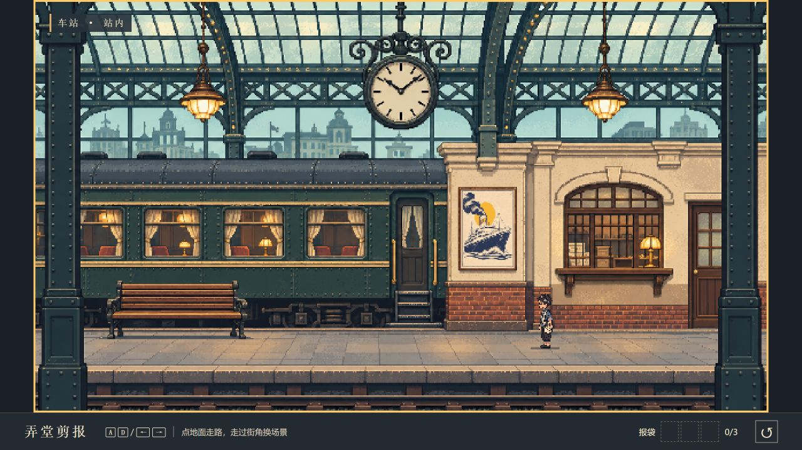

# 弄堂剪报 · Shanghai 1930

以 1930 年代上海街区为背景的横版像素冒险原型。小报童穿行于站内月台、里弄和影院门口，从墙上海报自由剪下图案，收入报袋。

项目目标是在四季中的老上海探索，从旧海报以及 NPC 赠予的杂志、宣传册等材料中自由剪切，收集元素，为社区露天电影院拼贴海报。四季、NPC 对话与赠予材料、拼贴工作台尚未实现，下面的「当前内容」说明现有可玩范围。

## 项目文档

- [协作与开发约定](AGENTS.md)：任务范围、Git 流程、验证与交付。
- [游戏设计](docs/GAME_DESIGN.md)：四季探索、材料获取、剪切收集与社区电影海报的玩法主线。
- [美术方向](docs/ART_DIRECTION.md)：上海年代感、低分辨率像素、复古配色与场景交互表现。



## 开始试玩

下载或克隆仓库后，用浏览器打开根目录的 `index.html`。无需安装依赖、构建或联网。

| 操作 | 功能 |
| --- | --- |
| A / D、左右方向键 | 左右行走 |
| 点击地面 | 走到指定位置 |
| 走进画面左右边缘 | 被前景建筑遮挡后进入相邻地点 |
| 点击海报，或走近后按 E | 查看墙上海报 |
| 按住鼠标或手指圈选 | 自由选择剪片，松开后自动闭合 |
| E 或“确认剪下” | 将选中的图案收入报袋 |
| Esc | 返回街上 |
| R 或右下角重置按钮 | 重新开始 |

触屏设备另有左右移动按钮。

## 当前内容

- 三个可往返地点：**车站站内 ↔ 里弄 ↔ 影院门口**，起点为里弄。
- 四帧侧面行走动画；靠近边界时由前景立柱或墙角遮住角色，再切换场景。
- 每个地点一张可剪海报，支持不规则、凹形和自交轮廓，剪切前可预览或重画。
- 报袋与墙上海报的缺口在场景切换时保留；刷新页面或重新开始会清空。

这是独立的 JavaScript 试玩原型，目前包含探索和剪片收集，尚未包含最终海报拼贴工作台。

## 项目结构

```text
index.html         页面与交互面板
game.js            行走、换场、绘制、自由剪切与收集
layout.js          地点关系、角色尺寸、地面基线与海报位置
style.css          页面与小屏幕适配
assets/            三张场景、角色图集与三张海报
docs/              玩法、美术方向、预览与生成记录
scripts/build.mjs  可选的单文件打包工具
```

场景采用 **640 × 360** 原生画布，关闭图片平滑；角色图集为四个 **30 × 48** 像素帧。调整地图和交互位置可从 `layout.js` 开始。

## 可选：生成单文件试玩版

安装 Node.js 后，在仓库目录运行：

```sh
npm run check
npm run build
```

生成的 `dist/shanghai-1930.html` 内含代码和七张图片，可以独立离线打开。打包工具仅使用 Node.js 内置模块，无需运行 `npm install`。`dist/` 不纳入版本管理。

## 美术记录

背景与角色使用内置 imagegen 生成，海报沿用原型中的图案并转换为低分辨率贴图。完整提示词见 [场景记录](docs/art-prompts-scenery.txt) 与 [角色记录](docs/art-prompts-hero.txt)。街区与影院为原创游戏化设计，不是具体历史建筑的复原。
