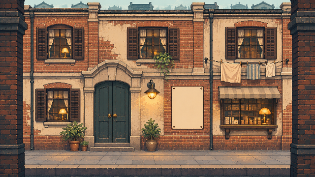
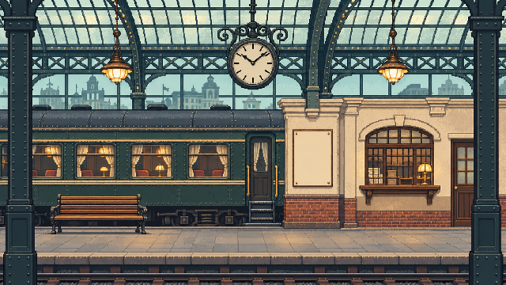

# 美术方向：四季中的老上海

本文件约定《弄堂剪报》的视觉方向。玩法与交互流程以 [游戏设计](GAME_DESIGN.md) 为准，当前运行方式见 [README](../README.md)。

## 1. 方向与当前状态

已确认方向：**1930 年代上海的日常街区、横版视角、低分辨率像素颗粒、复古配色、四季变化**。可探索场景既有人物，也有可交互的海报；玩家与 NPC 互动时进入对话模式，并可获得杂志、宣传册等剪切材料。收集的元素最终用于社区露天电影院的拼贴海报。

| 内容 | 当前状态 |
| --- | --- |
| 站内月台、里弄、影院门口 | 已有三张像素场景与横版行走小样 |
| 小报童与墙上海报 | 已有角色行走图集、三张可剪海报 |
| 四季场景表现 | 已确认方向，尚未制作与接入 |
| NPC、对话及赠予的印刷材料 | 已确认方向，尚未制作与接入 |
| 社区露天电影院与拼贴展示 | 已确认用途，场地表现、工作台与成品展示尚待设计 |

下文标为「建议」的色值、季节表现与界面构图是试作起点，不等于已锁定的内容清单。当前影院门口的图像不能当作社区露天放映场地已经完成。

## 2. 上海年代感

以普通人的街区生活建立年代感：砖墙与灰泥、石库门门框、木窗、站内铁构件、纸张与印刷招贴、衣物和日常小物。建筑与陈设要服务地点辨识和行走路线，避免每一块墙都堆满装饰。

人物应当像生活在这里的人，有不同年龄、体态、职业与穿着。服饰先考虑人物用途与轮廓，不把旗袍、礼帽、长衫或特定发型变成所有人的统一身份标签。当前小报童保留短发、蓝灰衬衣、深色裤装与浅色报袋的辨识关系；后续服装细化不依靠夸张的贫困或异域化符号。

街区采用原创的时代氛围设计，不把当前建筑、招牌或人物描述成具体史料复原。需要对应某座真实建筑或具体年份时，再为该素材核对依据。避开现代电子屏、塑料广告灯箱、赛博朋克霓虹和与项目无关的现代设备。

## 3. 当前图像参考

以下图像是已有原型的构图与氛围参考，尚不是最终质量标杆或不可调整的风格锚点。后续可以简化过密的砖墙、玻璃和颗粒细节，让人物与交互物在低分辨率下更清楚。

里弄：正面展开的立面、暖砖与青灰门窗、连续人行地面、两侧前景墙角。空白纸面用于独立叠加可交互海报。

车站：必须保持站内／月台辨识，车厢、顶棚与候车设施应在场景中可见。两侧近景结构提供进入下一场景前的遮挡。

另外可查看 [当前影院背景](../assets/cinema.png)、[当前角色图集](../assets/hero.png) 与 [实际试玩画面](preview.jpg)。这些参考中的场景目前没有 NPC，新增人物不能仅靠在背景上画几个人来替代可交互角色。

## 4. 像素与视角

「低像素颗粒」按低分辨率、可见且清晰的像素块执行。轮廓用有组织的色块表达，重点放在人物姿态、建筑形状和纸面图案。不要用高分辨率插画加满屏马赛克滤镜来代替像素设计。

| 项目 | 当前制作基线 | 后续调整原则 |
| --- | --- | --- |
| 场景画布 | 640 × 360 | 沿用统一逻辑像素网格；改变基准需一起核对角色、海报和界面 |
| 主角图集 | 四帧，每帧 30 × 48；当前显示高 48 像素 | NPC 依相同世界比例制作，不把所有年龄和体型画成同高 |
| 可剪海报贴图 | 当前 128 × 160 | 图案先满足剪切辨识，再确定其他纸张的尺寸与比例 |
| 放大显示 | 关闭图片平滑，采用最近邻呈现 | 优先整倍数预览；适配窗口时保持比例，避免一部分素材模糊、一部分锐利 |

上述数值记录当前原型，不要求所有未来素材强行套成同一尺寸。提交新资产时写清原生尺寸、帧数和落脚基线，避免靠随意拉伸解决比例问题。

镜头保持水平侧视，玩家沿一条横向地面行走。建筑纵向线条基本竖直；背景可有浅层空间，但不改成 45° 斜俯视、等距地图或沿纵深走入街道的移动方式。前景遮挡与换场规则见游戏设计。

像素边缘保持明确，阴影和灯光用有限的明暗层级组织。少量抖色可用于局部材质；避免满屏随机噪点、柔焦轮廓、连续大渐变和密集闪烁。动画帧的颗粒大小与角色比例保持一致。

## 5. 复古配色

整体色调以低至中饱和度为主，使用纸张暖色、旧砖红褐、青灰阴影和少量灯光暖色。人物和可剪图案需要独立于背景的明度或色相，不通过提高全场饱和度来突出交互。

以下是供试作比较的建议色组，**尚未锁定为最终色表**：

| 颜色角色 | 建议色值 | 用途 |
| --- | --- | --- |
| 深青灰 | `#243D44` | 近景结构、较深衣物和大块阴影 |
| 旧砖褐 | `#97694D` | 砖墙与木质暖色，保留层次变化 |
| 纸张米色 | `#D9C69C` | 旧纸、灰泥亮面、界面底色起点 |
| 灯光琥珀 | `#C79A4B` | 局部照明与少量暖色重点 |
| 暗朱红 | `#7E4742` | 招贴、布面与印刷图案的点缀 |

纸张可以旧而清楚，不能把所有颜色统一染成棕黄。海报中的红、蓝、绿等套色可更鲜明，但要与场景的明度范围相容；重要主体不被纸纹和做旧痕迹淹没。

## 6. 四季的表现

四季都属于目标体验。以下仅给出可探索的视觉变化，不规定季节推进方式、每季地图数量或完整素材清单；这些取舍在游戏设计中确定。

| 季节 | 试作建议 | 保持一致的部分 |
| --- | --- | --- |
| 春 | 少量嫩绿、较柔的亮面、局部湿润地面或新张贴纸张 | 地点轮廓、横向行走基线与交互辨识 |
| 夏 | 较强的日照与阴影对比，局部遮阳、轻薄衣物和绿意 | 避免全屏高饱和绿色或过曝白色 |
| 秋 | 偏暖的纸色、低饱和赭色点缀、局部落叶或换季陈设 | 不把每个地点都覆盖成相同的橙色 |
| 冬 | 较冷的环境色与局部暖灯，衣物厚度变化 | 不默认所有冬景都有大雪；仍需看清人物与纸面 |

建议优先复用街区结构，通过有限的光色、陈设、人物与可获得印刷物体现变化。季节辨识不能只依赖整张图片套一层滤镜，也不意味着每一季必须重画所有建筑。

## 7. 场景、NPC 与海报的可读性

目标场景需要同时容纳可对话的人物与可剪切的墙上海报。两类互动在视觉上可区分，玩家靠近时能知道将进入对话还是查看纸面。具体输入与优先级由游戏设计规定。

| 图层／对象 | 制作要求 |
| --- | --- |
| 背景建筑与环境 | 提供地点与季节信息，为角色行走、人物停留和海报留出清晰区域 |
| 独立海报 | 纸面主体、边缘和位置清楚；可剪纸面独立覆盖在背景上，支持保留剪后缺口 |
| 主角与 NPC | 单独制作透明精灵，落脚点与地面一致；通过姿态、服色与轮廓区分身份 |
| 近景建筑 | 在角色前绘制；换场入口处确实遮住角色，不能只放一个看起来像入口的标识 |
| 对话和纸面查看界面 | 独立叠层，维持文字、人物与材料图案的清晰阅读 |

交互海报与装饰海报可以共存，但装饰不能与可剪海报呈现完全相同的反馈。建议使用靠近后的小提示、轻微描边或稳定的明度差，避免让所有人物和纸张持续闪烁、发光或漂浮。

人物停留位置、对话焦点和可剪海报不应被前景入口长期遮挡。背景中的台阶、箱子和家具也不要盖住角色应当行走的横向通道。

## 8. 对话与印刷材料

与 NPC 互动进入对话模式是已确认的玩法要求；**对话界面的具体版式尚未实现，以下为初版建议**。

建议保留可辨识的谈话人物或其头像，以人物称呼、正文和明确的继续／结束操作组织信息。优先复用人物素材或制作小头像，不默认每个 NPC 都需要额外的大幅立绘。面板可以借用纸张底色和简洁印刷边框，装饰让位于文字。

中文正文可使用清晰的常规字体，像素风不要求把长对话压进难读的像素字。对话面板要适配小屏幕，避免盖住全部人物，也不要把正文直接画进人物或场景图片。

NPC 给予杂志、宣传册等材料时，建议用独立封面或纸页预览说明获得了什么。纸面应有可辨识、可圈选的图案区域；封面、排版和折痕帮助区分材料种类，不能妨碍自由剪切。对话结束后如何查看与剪切材料，以游戏设计的流程为准。

社区露天电影海报需要留出拼贴元素的阅读层次。成品纸面与展示场地的比例、标题和放映信息如何参与排版，尚待拼贴玩法确认；不预先烘焙成一张不能编辑的最终成品图。

## 9. 素材交付与画面核对

- 场景、人物、可剪纸面和界面分开交付。主角与 NPC 使用真实透明背景的 PNG；不得带棋盘底、矩形底色或多余柔边光晕。
- 角色动画保持统一单帧尺寸与落脚基线，提供帧序说明。透明边界与帧间留白不能裁掉头发、报袋或脚步。
- 海报与其他印刷物保留独立正面图。来源、剪片预览和拼贴中的主体、颜色与裁剪轮廓应能相互对应；剪切几何不需要被强制吸附到像素方格。
- 检查原生尺寸与实际游戏显示：轮廓清楚、角色比例一致、交互对象可辨识、对话文字可读、季节变化仍保留地点特征。
- 接入前检查背景与独立层有没有重复人物或重复纸面，近景遮挡是否完整，以及剧情材料是否被当成普通装饰。
- 运行素材放入仓库 `assets/`，必要的可编辑源文件与制作说明一并保留。只提交选定素材和少量有用预览，不提交整轮原始候选、重复压缩包或个人目录引用。

[场景生成记录](art-prompts-scenery.txt) 与 [角色生成记录](art-prompts-hero.txt) 用于追溯已有素材。旧记录中的「背景无人」只描述背景层制作，不能覆盖新增独立 NPC 的方向。外部参考图必须实际查看后才能声称已对齐；未能查看的 Pinterest 图不作为本文件的已确认视觉依据。
